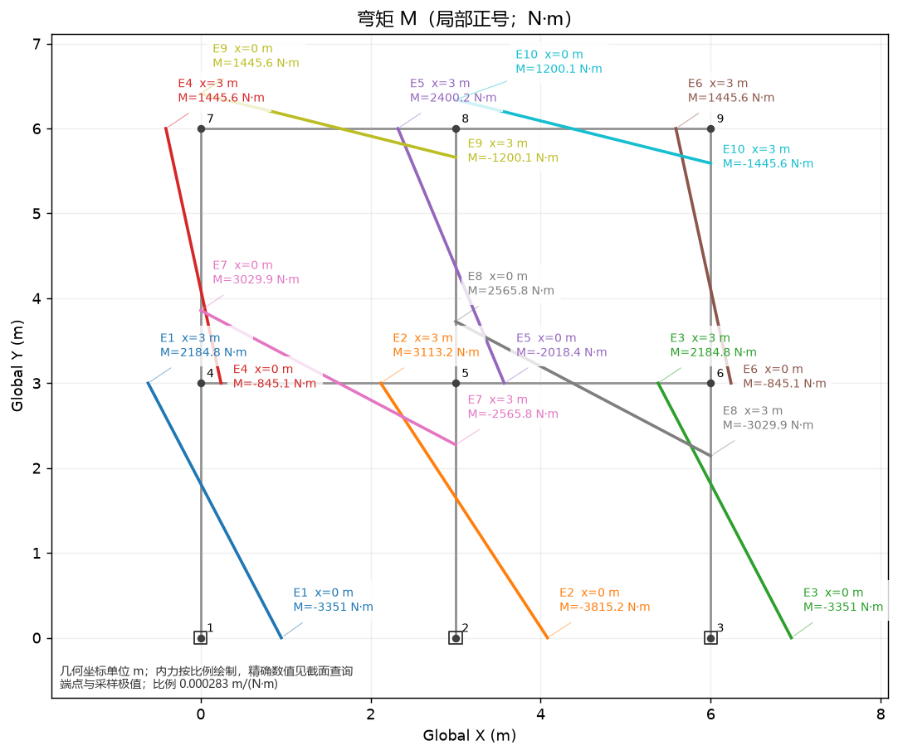

# 结构力学 · 矩阵位移法教学系统

## GitHub 备份（2026-11-10）

已按要求清理本地旧版本：删除 V1.1～V1.1.4 历史归档及 4 个旧程序目录，释放约 957.5 MiB。本地程序仅保留 V1.1.5；历史版本从下方 GitHub Releases 下载。删除前已重新核对 12 个远端附件的 SHA256。源码、示例、验收记录和 Git 工作副本保留。

- 私有仓库：[ZeyuWen17/MatrixDisplacement](https://github.com/ZeyuWen17/MatrixDisplacement)。
- V1.1～V1.1.5 源码快照已按版本提交并建立标签；历史快照提交时间为导入日期。
- [历史发布附件](https://github.com/ZeyuWen17/MatrixDisplacement/releases)：V1.1 仅源码；V1.1.1～V1.1.4 保留原有源码和 Windows ZIP；V1.1.5 本轮仅发布源码，没有新建 ZIP。
- 上传用独立 Git 工作副本位于 `source/matrix_displacement_v11/outputs/github/MatrixDisplacement`。日常源码修改不会自动同步，需要显式更新并推送。

当前版本：V1.1.5。目录整理日期：2026-11-07。

使用说明核对日期：2026-11-08。

### 最新源码修改（2026-11-09）

- 内力标签新增按实际文字尺寸的自动避让，在窗口缩放和导出时重新排布，保留引线与全部标签。两跨两层、10 根杆件刚架通过两种图幅的文字框无重叠检查及重复绘制稳定性测试；[验收图](source/matrix_displacement_v11/docs/assets/acceptance-2026-11-09/dense_frame_labels.png)已视觉核对。
- 最新完整回归：292 passed、1 skipped。避让优先减少标签与标签、节点编号和说明文字的重叠；不保证所有密集模型完全无重叠，也不保证引线与结构线互不交叉。

- 顶部新增“内力图数值”下拉框：隐藏数值、仅采样极值、端点与采样极值。计算后切换即可刷新 N/V/M 三张图，不重新求解，也不修改模型；导出 PNG 使用当前模式。
- “仅采样极值”显示每根杆件的采样最大值和最小值；多根杆件的局部 x 均从各自 i 端起算。密集模型建议先选择该模式，必要时隐藏数值并用截面查询。
- 标签保留引线。已验证连续梁、三角桁架三种模式切换与图片输出，连续梁早期交错排布示例见[标注图](source/matrix_displacement_v11/docs/assets/acceptance-2026-11-09/continuous_labels.png)；最新刚架避让效果见上方验收图。
- 本轮原有全量回归 289 passed、1 skipped；新增两项 Qt 模式切换和导出测试 2 passed。上述功能已合入 V1.1.5 EXE。

- 内力图增加杆件端点、采样最大/最小值标注（杆件编号、沿杆件局部 x、实际内力及单位）。极值来自采样，不是解析极值；精确位置请结合截面查询。
- 图底部说明几何坐标单位及内力显示比例；有微软雅黑、黑体或 Noto Sans CJK SC 时使用中文标题和说明，否则回退英文。示例见[带数值标注的弯矩图](source/matrix_displacement_v11/docs/assets/acceptance-2026-11-09/moment_labeled.png)。
- 本次绘图修改验证：原有完整回归 288 passed、1 skipped；新增标注测试单独运行 1 passed。请关闭旧版本后启动 V1.1.5 程序。

- 固定支座（同时约束 ux、uy、rz）改为固定端斜线符号，保留自由度文字标注。
- 数值结果使用系统等宽字体，改善数字列对齐。
- 完整自动回归：288 passed、1 skipped。V1.1.5 EXE 已重建并通过离屏自检，可直接双击运行。
- 人工验收已完成悬臂梁建模、求解、保存、撤销/重做及重开；2026-11-09 补充完成修改后的界面复核，以及默认算例的报告、CSV、PNG 实际菜单导出。详见[人工验收记录](source/matrix_displacement_v11/docs/GUI_ACCEPTANCE_2026-11-09.md)。手工模型保存在 `source/matrix_displacement_v11/outputs/acceptance/2026-11-08/cantilever.json`，采用默认 E=2.1e11 Pa，与教程练习的 E=2e11 Pa 不同。

## 工作入口

- [任务单与详细说明](source/matrix_displacement_v11/任务单.md)
- [更新记录](source/matrix_displacement_v11/CHANGELOG.md)
- [V1.1.5 验证记录](source/matrix_displacement_v11/docs/V1.1.5_VALIDATION.md)
- [历史 Windows 程序下载（最高 V1.1.4）](https://github.com/ZeyuWen17/MatrixDisplacement/releases/tag/v1.1.4)

后续直接修改文件、验证并更新 README，只有明确要求时才打包。

## 程序使用说明

建议按“先运行自带算例 → 自己建一个悬臂梁 → 保存并导出结果”的顺序学习。

### 1. 打开程序

**从 GitHub 首次下载：** 本仓库为私有仓库，需要登录有访问权限的 GitHub 账号。可在仓库首页选择 Code → Download ZIP 并解压，或使用 Git 克隆仓库。GitHub 上的 V1.1.5 只有源码，没有 Windows 安装包；本机已有的 V1.1.5 EXE 不包含在源码下载中。需要历史免安装程序时，下载上方 V1.1.4 Release 的 Windows ZIP，解压整个目录后运行。

首次运行 V1.1.5 源码，在 Windows 安装 Python 3.12（本项目验证版本为 3.12.5），进入下载目录中的 `source/matrix_displacement_v11`，在 PowerShell 执行：

```powershell
py -3.12 -m venv .venv
.\.venv\Scripts\python.exe -m pip install -r requirements-gui.txt
.\.venv\Scripts\python.exe -m matrix_displacement.gui
```

安装依赖需要联网。后续启动只执行最后一行；无需激活虚拟环境。若提示找不到 Python，请先安装 Python 3.12，再重新打开 PowerShell。

**方式一：使用本机已构建的 Windows 程序。** 以下路径仅适用于开发电脑已有文件，不是 GitHub 下载入口。打开文件夹，双击 `MatrixDisplacement.exe`：

```text
source/matrix_displacement_v11/outputs/dist/V1.1.5/MatrixDisplacement/
```

EXE 旁的 `_internal` 文件夹是运行所需依赖，不能删除，也不能只复制 EXE 到其他位置。

**方式二：运行当前源码。** 如果要使用后续直接修改的程序，请在 `source/matrix_displacement_v11` 文件夹中打开 PowerShell，执行：

不熟悉命令行时，可以先在文件资源管理器打开上述源码文件夹，在地址栏输入 `powershell` 并回车，再输入下面的命令：

```powershell
.\.venv\Scripts\python.exe -m matrix_displacement.gui
```

修改源码不会自动更新已打包的 EXE，因此日常开发后的新功能以源码运行结果为准。这里使用项目已有虚拟环境，不需要每次安装依赖。

### 2. 先用自带算例熟悉界面

1. 打开程序后，默认显示悬臂梁。也可以从“教学算例”菜单选择“悬臂梁：杆件均布 + 集中荷载”“两跨连续梁”或“三角形平面桁架”。
2. 在顶部选择“教学模式（保留组装矩阵）”。
3. 点击顶部“计算并显示结果（Ctrl+R）”，或按 `Ctrl+R`。
4. 右侧切换到“计算结果”，依次查看“数值结果”“杆件截面查询”“轴力 N”“剪力 V”“弯矩 M”“变形图”。
5. 如需返回结构图，点击“建模画布”。

默认悬臂梁算例的支座竖向反力应为 **5500 N**，支座反力矩为 **10790 N·m**，自由端竖向位移约为 **−0.0249243 m**。这些数值仅适用于未修改的默认算例。

**界面分区：** 顶部是文件菜单、模式选择和计算入口；左侧是建模工具、属性表、荷载表及导出按钮，内容较长时可向下滚动；右侧是建模画布和计算结果；底部状态栏显示操作反馈及异常提示。

### 3. 输入前先统一单位与方向

| 输入量 | 程序单位 | 示例 |
| --- | --- | --- |
| 坐标、杆长、位移 | m | 4000 mm 输入 `4` |
| 节点力、集中力 | N | 1 kN 输入 `1000` |
| 分布荷载 | N/m | 2 kN/m 输入 `2000` |
| 弹性模量 E | Pa | 200 GPa 输入 `2e11` |
| 截面积 A | m² | 100 cm² 输入 `0.01` |
| 截面惯性矩 I | m⁴ | 可用科学计数法，如 `8e-6` |
| 力矩、弯矩 | N·m | 1 kN·m 输入 `1000` |
| 转角 | rad | 不要直接输入角度值 |

整体坐标 **X 向右、Y 向上**，向下的整体竖向力填负值。杆件局部 x 轴从 i 端指向 j 端；斜杆荷载务必确认选择的是“杆件局部坐标系”还是“整体坐标系”，不能把局部横向直接当作全局竖向。

### 4. 从零建立一个悬臂梁

下面建立一个长 4 m、左端固定、右端受 1000 N 向下集中力的模型。

1. **新建：** 选择“文件 → 新建空白模型”（`Ctrl+N`）。若当前模型有修改，先按提示保存或放弃。
2. **选择单元：** 左侧“新建杆件类型”选择“平面刚架 Frame2D”。它既可承受轴向作用，也可承受弯曲，用它建立本例。
3. **设置材料与截面：** 在没有选中杆件时，点击“设置默认 E、A、I / 选中杆件属性”，输入 `E=2e11`、`A=0.01`、`I=8e-6`。默认参数只影响以后新建的杆件；已有杆件需要选中后再修改。
4. **建立节点：** 点击“精确输入节点坐标”，分别添加 `(0, 0)` 和 `(4, 0)`。也可用“绘制节点”在画布点击，但本例建议精确输入。
5. **连接杆件：** 点击“连接杆件（连续点两节点）”，先点击左节点，再点击右节点，建立一根由左向右的杆件。按 `Ctrl+0` 可显示全模型。
6. **设置固定支座：** 点击“设置支座 / 给定位移”，再点击左节点。勾选 `ux`、`uy`、`rz`，数值均填 `0`；右节点保持自由。
7. **设置荷载：** 点击“设置节点荷载”，再点击右节点，输入 `Fx=0`、`Fy=-1000`、`Mz=0`。这是节点力，不要误填到杆件均布荷载中。
8. **计算：** 选择教学模式并点击顶部计算按钮。左支座竖向反力应为 `1000 N`，反力矩应为 `4000 N·m`；自由端应向下变形。
9. **保存：** 按 `Ctrl+S`，选择你方便管理的文件夹，保存为例如 `悬臂梁练习.json`。

如果第 8 步提示结构不稳定，首先检查杆件是否真正连接两个节点，以及左端三个自由度是否都已约束。

完成练习后，可用下表核对结果。这是本节“仅自由端节点力”的练习，和第 2 节含均布及杆内集中荷载的默认算例不同。

| 检查量 | 本节练习的预期值 |
| --- | --- |
| 左支座竖向反力 | `1000 N` |
| 左支座反力矩 | `4000 N·m` |
| 右端竖向位移 uy | 约 `-0.0133333 m`，即向下 `13.3333 mm` |
| 右端转角 rz | 约 `-0.005 rad` |

以上练习参数已通过程序数值内核核对；负位移表示向下。保存模型以后，可以将右端荷载改成 `Fy=-2000`，重新计算，观察在线弹性条件下反力、位移和转角变为原来的两倍，再用 `Ctrl+Z` 撤销修改并重新计算。

### 5. 建其他结构时怎么选

| 单元类型 | 适用对象 | 使用要点 |
| --- | --- | --- |
| `Frame2D` | 平面刚架、一般梁柱 | 节点含 `ux、uy、rz`，可在杆件属性中设置端部转角释放 |
| `Beam2D` | 水平连续梁 | 仅用于从左至右的水平杆件，节点含 `uy、rz`；不要用它画斜杆或柱 |
| `Truss2D` | 平面桁架 | 只承受轴力，荷载施加在节点，不支持直接添加杆件荷载 |

支座窗口中，勾选表示该自由度位移已知，填 `0` 表示零位移约束；不勾选表示该方向自由。对于 Frame2D，固定支座约束 `ux、uy、rz`，铰支座通常约束 `ux、uy` 而放开 `rz`；支承水平梁的竖向滚动支座通常只约束 `uy`。具体仍须符合题目的支座方向。

不要把“节点支座”和“杆端转角释放”混为一谈：前者约束节点运动，后者改变杆端的弯矩传递。新手可先使用自带连续梁和桁架算例，再逐项修改。

### 6. 添加、修改荷载和模型

- **杆件荷载：** 点击“添加杆件荷载”后点选杆件，可选均布、杆内集中力或线性分布荷载。集中力位置按“距 i 端位置 x”输入；线性荷载分别输入 i、j 两端值。对本例从左向右的水平杆，向下均布荷载可填局部 `qx=0、qy=-1000 N/m`。
- **修改已有荷载：** 在左侧“杆件荷载表”选中一行，再点“修改所选荷载”或“删除所选荷载”。重复“添加”会增加另一项荷载，不会替换原项。节点荷载窗口则替换该节点对应的荷载值。
- **修改几何和属性：** 切换到选择工具，点击节点或杆件，再点“编辑选中的节点 / 杆件”；也可从杆件属性表选中杆件。节点坐标可精确输入，也可拖动。
- **多选与批量修改：** `Ctrl` 点击可增减选择；从左向右框选要求对象包含在框内，从右向左为交叉选择。批量平移节点、批量修改杆件 E/A/I 可用左侧按钮或“编辑”菜单。
- **操作纠错：** `Ctrl+Z` 撤销，`Ctrl+Y` 重做。删除节点可能同时删除与它相连的杆件，执行前查看确认提示。
- **视图控制：** 滚轮缩放、中键拖动平移，或选择“平移画布”工具后左键拖动；`Ctrl+0` 适应窗口。默认吸附网格为 0.5 m，需要任意位置时取消吸附或精确输入坐标。

**修改模型后必须重新计算。** 修改前的结果不能用来判断修改后的结构。

### 7. 读结果和导出

**教学模式与快速模式：** 两种模式共用求解算法。教学模式保留中间矩阵和组装记录，可导出教学报告；快速模式减少中间记录。如果快速模式下需要教学报告，应切回教学模式并重新计算。

- **数值结果：** 查看节点自由度位移、支座反力和单元局部杆端力。位移使用 m/rad，力使用 N/N·m。自由自由度上接近零的残余数值可能来自浮点舍入。
- **截面查询：** 在“杆件截面查询”选择杆件及距 i 端的 x，读取 N、V、M 和位移；集中力位置可分别查看左、右极限。也可点击内力图中的曲线，进入对应截面查询。
- **内力图：** 图形纵向偏移采用自动缩放，画布上的整体 Y 坐标不是内力数值。需要某处的准确显示值时，应使用截面查询或 CSV；符号按程序局部坐标约定理解。
- **变形图：** 通常为放大显示，放大倍数写在图题中；实际位移看数值结果，不能直接拿放大图量位移。
- **教学报告：** 完成教学模式计算后，选择“分析与导出 → 导出教学报告”，保存 `.md` 文件，可查看矩阵与组装过程。
- **CSV：** 选择“分析与导出 → 导出 CSV 数据”，指定一个文件夹，程序会在其中创建 `csv_results` 子目录。
- **PNG：** 先切换到轴力、剪力、弯矩或变形图标签，再选“分析与导出 → 保存当前结果图”。停留在数值表格页时不能导出当前图。

图形和内力范围基于截面采样，不能把采样最大值无条件当作严格解析极值。

### 8. 保存、打开与自动恢复

- `Ctrl+S` 保存 JSON 模型，`Ctrl+Shift+S` 另存为，`Ctrl+O` 打开已有 JSON。标题中的 `*` 表示有未保存修改。
- JSON 保存的是结构模型，不是当前结果图片或完整计算会话；重新打开后应重新计算，需要报告和图片时分别导出。
- 若原 JSON 被其他程序修改或删除，保存前会提示冲突。建议“另存为”保留两个版本；“仍然覆盖”会替换磁盘版本；“取消”保留当前未保存修改。
- 自动恢复在修改停止约 **2.5 秒**后写快照，另有 **60 秒**定时兜底，不等于每次编辑即时备份。
- 意外退出后重新启动，可按提示恢复草稿，也可用“文件 → 恢复自动保存草稿...”打开选择器。恢复只载入模型，不自动覆盖原 JSON；检查无误后建议先另存为。
- 如果提示旧草稿清理失败，文件仍可能保留并在下次启动出现。应核对时间和内容，避免用旧草稿覆盖较新的手动保存文件。

默认 Windows 恢复目录为 `%LOCALAPPDATA%\MatrixDisplacement\recovery`；未处理 GUI 异常日志通常位于 `%LOCALAPPDATA%\MatrixDisplacement\logs\gui_errors.log`。自动恢复不包含撤销历史、窗口布局或计算结果。

### 9. 常见问题与快捷键

| 情况 | 优先检查 |
| --- | --- |
| 提示机构、奇异或病态刚度矩阵 | 支座是否充分、杆件是否连到节点、是否有孤立节点、释放是否过多、E/A/I 是否合理 |
| 位移明显过大或过小 | 是否混用了 kN 与 N、mm 与 m、GPa 与 Pa；截面惯性矩是否使用 m⁴ |
| 荷载方向不对 | 正负号、局部/整体坐标系，以及杆件 i→j 的方向 |
| 看不到模型 | 按 `Ctrl+0`，确认当前处于“建模画布” |
| 新设置的 E/A/I 没有改变旧杆件 | 默认值只影响新杆件，已有杆件需选中修改或批量修改 |
| 无法导出教学报告 | 切到教学模式重新计算 |
| 保存提示权限错误 | 换到有写权限的文件夹，检查文件是否被其他程序占用；不要直接忽略未保存标志 |

| 快捷键 | 功能 |
| --- | --- |
| `Ctrl+N` / `Ctrl+O` | 新建 / 打开模型 |
| `Ctrl+S` / `Ctrl+Shift+S` | 保存 / 另存为 |
| `Ctrl+R` | 运行分析 |
| `Ctrl+Z` / `Ctrl+Y` | 撤销 / 重做 |
| `Ctrl+A` / `Escape` | 全选 / 清除选择（建模操作时使用） |
| `Delete` | 删除所选对象 |
| `Ctrl+M` | 批量平移所选节点 |
| `Ctrl+0` | 全模型适应窗口 |

当前程序用于二维线弹性静力分析和教学，暂不支持空间结构、非线性、动力学或规范设计。重要结果请结合教材解析解或独立计算核对。

## 当前目录

下面列出开发电脑的目录。GitHub 源码不含 `.venv`、`outputs`、本地恢复草稿及历史 ZIP；文档示例图片位于 `docs/assets`。

```text
结构力学/
├── README.md
├── source/matrix_displacement_v11/
│   ├── 任务单.md               需求、进度与待办事项
│   ├── matrix_displacement/   程序源码
│   ├── tests/                 自动化测试
│   ├── examples/              教学示例代码
│   ├── docs/                  功能与验收文档
│   ├── scripts/               构建、验收工具
│   ├── outputs/
│   │   ├── examples/          示例数据与图片
│   │   ├── build/             构建中间文件
│   │   └── dist/V*/           按版本保存的 Windows 程序
│   ├── reports/
│   │   ├── validation/        验证报告、日志及原有验证缓存
│   │   └── original-source/   原始校验记录
│   └── .venv/                 项目环境，保持原路径
└── archive/
    ├── releases/              历史包已迁往 GitHub Releases，本地已清理
    └── docs/                  整理前 README 快照
```

在源码目录运行 `.\.venv\Scripts\python.exe -m matrix_displacement.gui` 可启动源码版。打包程序必须保留其完整目录和 `_internal`。

目录名保留 `matrix_displacement_v11` 以维持虚拟环境路径；实际包版本为 1.1.5。高 DPI、多显示器及跨电脑验收仍待完成。

## 示例效果

下图是两跨两层刚架的弯矩图，标注显示实际弯矩，几何坐标单位为 m。



## 后续同步方式

当前开发目录与上传用 Git 工作副本是两个目录，修改不会自动同步。

1. 在开发目录修改源码或文档，完成对应验证。
2. 在上传工作副本先检查 `git status --short`，处理已有修改，然后执行 `git pull --ff-only`；失败时停止，不覆盖远端内容。
3. 将本次明确修改的文件按相同相对路径复制到工作副本。README 的图片放入 `docs/assets`；不要复制 `.venv`、`outputs` 或缓存。
4. 使用 `git diff --stat` 和 `git diff` 核对范围，用 `git add -- 文件路径` 只暂存本次文件，然后提交并执行 `git push origin main`。
5. 核对远端提交和文档链接。日常修订更新 main，不移动已发布版本标签；只有发布新版本时才新增标签和 Release。

如果是直接从 GitHub 克隆的开发目录，可在该克隆内开发和推送，无需再维护第二份工作副本。


