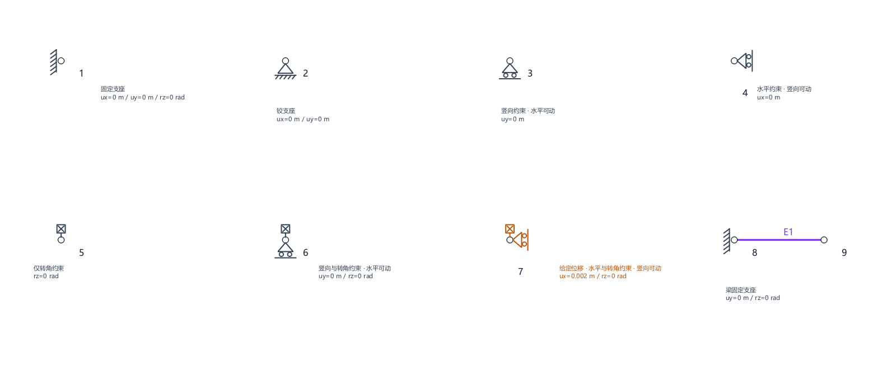

# 程序使用指南

本指南适用于 V1.1.9。安装步骤见[项目首页](../../../README.md#安装与启动)。

V1.1.9 新增模型检查与支座预设：

- **模型检查**：“分析与导出 → 检查模型并定位问题”主动检查；点击界面的计算入口也会先检查。点击问题列表中的一项，画布选中并缩放至相关节点/杆件。检查定位视图暂不显示荷载与尺寸，原模型不变。
- **分级处理**：“错误”需先修正；“建议”允许核对后继续计算。孤立/重合节点、多个独立结构组不一定非法，因此不会直接禁止计算。未发现问题也不等于结构稳定，求解器仍会检查刚度。
- **支座预设**：支座设置窗口可选自由、固定、铰接、水平可动、竖向可动。“固定”约束当前单元的全部有效自由度，不能使用的方向禁用。预设仅改变勾选，保留已输入位移数值；普通支座请确认数值为 0。
- **实时预览**：勾选及输入变化后更新符号、约束值与单位。非零值显示“给定位移”；无效输入显示提示。点击确定才应用到模型，取消不改变原约束。

## 1. 打开程序

在 `source/matrix_displacement_v11` 目录运行：

```powershell
.\.venv\Scripts\python.exe -m matrix_displacement.gui
```

后续启动无需重新安装依赖。若使用 Windows 发布包，请解压完整目录后运行 `MatrixDisplacement.exe`，并保留旁边的 `_internal` 文件夹。旧版本可能不包含本文全部功能。

建议按“先运行自带算例 → 自己建一个悬臂梁 → 保存并导出结果”的顺序学习。

## 2. 先用自带算例熟悉界面

1. 打开程序后，默认显示悬臂梁。也可以从“教学算例”菜单选择“悬臂梁：杆件均布 + 集中荷载”“两跨连续梁”或“三角形平面桁架”。
2. 在顶部选择“教学模式（保留组装矩阵）”。
3. 点击顶部“计算并显示结果（Ctrl+R）”，或按 `Ctrl+R`。
4. 右侧切换到“计算结果”，依次查看“数值结果”“位移与反力表”“杆端力表”“杆件截面查询”“轴力 N”“剪力 V”“弯矩 M”“变形图”。
5. 如需返回结构图，点击“建模画布”。

默认悬臂梁算例的支座竖向反力应为 **5500 N**，支座反力矩为 **10790 N·m**，自由端竖向位移约为 **−0.0249243 m**。这些数值仅适用于未修改的默认算例。

计算在后台执行，状态栏显示忙碌提示；为防止模型与结果不一致，计算期间暂时禁用编辑及菜单。可以点击“取消本次计算”，程序会丢弃本次结果并等待当前数值求解安全结束，随后可继续编辑或关闭窗口。取消不是立即中止底层数值运算。

计算完成先显示数值结果，第一次切换至某张图时才绘制该图。重复查看复用图形；更改标注模式后按需刷新，导出自动使用最新模式。默认“自动”模式在超过 100 杆件时隐藏内力标注；仍可点击曲线查询详细数值。手动选择的标注模式优先。绘图分阶段显示进度，可点击状态栏取消；完整文字布局和单张 PNG 写入不可中途打断。批量导出分张执行，取消后保留完整图片，未完成图片不写入；状态栏显示数量与路径。

**界面分区：** 顶部是文件菜单、模式选择和计算入口；左侧是建模工具、属性表、荷载表及导出按钮，内容较长时可向下滚动；右侧是建模画布和计算结果；底部状态栏显示操作反馈及异常提示。

## 3. 输入单位与方向

数值输入框可直接带单位后缀，程序校验量纲后换算成 SI。例如 `210 GPa`、`-10 kN`、`2 kN/m`、`200 mm`、`800 cm⁴`。不带后缀仍按下表单位；支持科学计数法。单位区分大小写，平方/四次方可写 `cm2`、`cm^2`、`cm²`。结果、报告和 JSON 始终为 SI。

可用长度单位 m/mm/cm，力 N/kN/MN，应力 Pa/kPa/MPa/GPa，面积 m²/cm²/mm²，惯性矩 m⁴/cm⁴/mm⁴，力矩 N·m/kN·m/N·mm/kN·mm，分布力 N/m/kN/m/N/mm/kN/mm，转角 rad/deg/°。不同量纲会拒绝；例如力框不能填 mm。

| 输入量 | 程序单位 | 示例 |
| --- | --- | --- |
| 坐标、杆长、位移 | m | 输入 `4000 mm` 或 `4` |
| 节点力、集中力 | N | 输入 `1 kN` 或 `1000` |
| 分布荷载 | N/m | 输入 `2 kN/m` 或 `2000` |
| 弹性模量 E | Pa | 输入 `200 GPa` 或 `2e11` |
| 截面积 A | m² | 输入 `100 cm²` 或 `0.01` |
| 截面惯性矩 I | m⁴ | 可用科学计数法，如 `8e-6` |
| 力矩、弯矩 | N·m | 输入 `1 kN·m` 或 `1000` |
| 转角 | rad | 角度输入必须带 `deg` 或 `°` |

整体坐标 **X 向右、Y 向上**，向下的整体竖向力填负值。杆件局部 x 轴从 i 端指向 j 端；斜杆荷载务必确认选择的是“杆件局部坐标系”还是“整体坐标系”，不能把局部横向直接当作全局竖向。

## 4. 从零建立一个悬臂梁

下面建立一个长 4 m、左端固定、右端受 1000 N 向下集中力的模型。

1. **新建：** 选择“文件 → 新建空白模型”（`Ctrl+N`）。若当前模型有修改，先按提示保存或放弃。
2. **选择单元：** 左侧“新建杆件类型”选择“平面刚架 Frame2D”。它既可承受轴向作用，也可承受弯曲，用它建立本例。
3. **设置材料与截面：** 在没有选中杆件时，点击“设置默认 E、A、I / 选中杆件属性”，输入 `E=2e11`、`A=0.01`、`I=8e-6`。默认参数只影响以后新建的杆件；已有杆件需要选中后再修改。
4. **建立节点：** 点击“精确输入节点坐标”，分别添加 `(0, 0)` 和 `(4, 0)`。也可用“绘制节点”在画布点击，但本例建议精确输入。
5. **连接杆件：** 点击“连接杆件（连续点两节点）”，先点击左节点，再点击右节点，建立一根由左向右的杆件。按 `Ctrl+0` 可显示全模型。
6. **设置固定支座：** 点击“设置支座 / 给定位移”，再点击左节点。勾选 `ux`、`uy`、`rz`，数值均填 `0`；右节点保持自由。
7. **设置荷载：** 点击“设置节点荷载”，再点击右节点，输入 `Fx=0`、`Fy=-1000`、`Mz=0`。这是节点力，不要误填到杆件均布荷载中。
8. **计算：** 选择教学模式并点击顶部计算按钮。左支座竖向反力应为 `1000 N`，反力矩应为 `4000 N·m`；自由端应向下变形。
9. **保存：** 按 `Ctrl+S`，选择你方便管理的文件夹，保存为例如 `悬臂梁练习.json`。

如果第 8 步提示结构不稳定，首先检查杆件是否真正连接两个节点，以及左端三个自由度是否都已约束。

不稳定错误会尽可能列出相关节点与自由度，并在建模画布选中这些节点。非正刚度对角项可直接定位到对应自由度；近零刚度模态给出的只是排查候选，不能据此断定唯一故障原因，也不能盲目添加支座。

完成练习后，可用下表核对结果。这是本节“仅自由端节点力”的练习，和第 2 节含均布及杆内集中荷载的默认算例不同。

| 检查量 | 本节练习的预期值 |
| --- | --- |
| 左支座竖向反力 | `1000 N` |
| 左支座反力矩 | `4000 N·m` |
| 右端竖向位移 uy | 约 `-0.0133333 m`，即向下 `13.3333 mm` |
| 右端转角 rz | 约 `-0.005 rad` |

以上练习参数已通过程序数值内核核对；负位移表示向下。保存模型以后，可以将右端荷载改成 `Fy=-2000`，重新计算，观察在线弹性条件下反力、位移和转角变为原来的两倍，再用 `Ctrl+Z` 撤销修改并重新计算。

## 5. 建其他结构时怎么选

| 单元类型 | 适用对象 | 使用要点 |
| --- | --- | --- |
| `Frame2D` | 平面刚架、一般梁柱 | 节点含 `ux、uy、rz`，可在杆件属性中设置端部转角释放 |
| `Beam2D` | 水平连续梁 | 仅用于从左至右的水平杆件，节点含 `uy、rz`；不要用它画斜杆或柱 |
| `Truss2D` | 平面桁架 | 只承受轴力，荷载施加在节点，不支持直接添加杆件荷载 |

支座窗口中，勾选表示该自由度位移已知，填 `0` 表示零位移约束；不勾选表示该方向自由。对于 Frame2D，固定支座约束 `ux、uy、rz`，铰支座通常约束 `ux、uy` 而放开 `rz`；支承水平梁的竖向滚动支座通常只约束 `uy`。具体仍须符合题目的支座方向。

不要把“节点支座”和“杆端转角释放”混为一谈：前者约束节点运动，后者改变杆端的弯矩传递。新手可先使用自带连续梁和桁架算例，再逐项修改。

### 如何识别支座符号

| 约束 | 符号与含义 |
| --- | --- |
| ux、uy、rz | 固定端墙线与斜线，两个平动及转角均受约束 |
| ux、uy | 三角形加带斜线基线，铰支座，转角自由 |
| uy | 下方三角形加两个滚轮，限制竖向平动，允许水平移动 |
| ux | 侧向三角形加两个滚轮，限制水平平动，允许竖向移动 |
| rz | 节点上方带叉方框，只约束转角 |
| uy、rz / ux、rz | 对应方向滚动符号加带叉方框，同时约束该平动与转角 |
| 梁单元的 uy、rz | 仅连接 Beam2D 时显示“梁固定支座”及固定端墙线；梁单元没有 ux 自由度 |

带叉方框是本程序的转角约束辅助标记。支座文字列出自由度及数值，平动单位 m、转角单位 rad；非零给定位移显示橙色及“给定位移”提示。鼠标悬停符号可查看完整约束。结果图与导出 PNG 使用相同符号，非零给定位移也会标出数值。



符号表示整体 X/Y 方向约束，不表示任意倾斜方向的支座；请以实际勾选的自由度及给定值为准。

## 6. 添加、修改荷载和模型

- **杆件荷载：** 点击“添加杆件荷载”后点选杆件，可选均布、杆内集中力或线性分布荷载。集中力位置按“距 i 端位置 x”输入；线性荷载分别输入 i、j 两端值。对本例从左向右的水平杆，向下均布荷载可填局部 `qx=0、qy=-1000 N/m`。
- **修改已有荷载：** 在左侧“杆件荷载表”选中一行，再点“修改所选荷载”或“删除所选荷载”。重复“添加”会增加另一项荷载，不会替换原项。节点荷载窗口则替换该节点对应的荷载值。
- **修改几何和属性：** 切换到选择工具，点击节点或杆件，再点“编辑选中的节点 / 杆件”；也可从杆件属性表选中杆件。节点坐标可精确输入，也可拖动。
- **多选与批量修改：** `Ctrl` 点击可增减选择；从左向右框选要求对象包含在框内，从右向左为交叉选择。批量平移节点、批量修改杆件 E/A/I 可用左侧按钮或“编辑”菜单。
- **操作纠错：** `Ctrl+Z` 撤销，`Ctrl+Y` 重做。删除节点可能同时删除与它相连的杆件，执行前查看确认提示。
- **视图控制：** 滚轮缩放、中键拖动平移，或选择“平移画布”工具后左键拖动；`Ctrl+0` 适应窗口。默认吸附网格为 0.5 m，需要任意位置时取消吸附或精确输入坐标。

**修改模型后必须重新计算。** 修改前的结果不能用来判断修改后的结构。

## 7. 读结果和导出

**教学模式与快速模式：** 两种模式共用求解算法。教学模式保留中间矩阵和组装记录，可导出教学报告；快速模式减少中间记录。如果快速模式下需要教学报告，应切回教学模式并重新计算。

V1.1.6会记住本次运行中最近一次成功导出的目录，报告、CSV 和图片共用这个位置。已保存模型的报告和图片默认带模型名前缀，仍可在保存对话框修改。没有保存过的模型继续使用通用默认名称；CSV 仍以编号子目录区分各次导出。

- **数值结果：** 查看节点自由度位移、支座反力和单元局部杆端力。位移使用 m/rad，力使用 N/N·m。自由自由度上接近零的残余数值可能来自浮点舍入。
- **截面查询：** 在“杆件截面查询”选择杆件及距 i 端的 x，读取 N、V、M 和位移；集中力位置可分别查看左、右极限。也可点击内力图中的曲线，进入对应截面查询。
- **内力图：** 图形纵向偏移采用自动缩放，画布上的整体 Y 坐标不是内力数值。需要某处的准确显示值时，应使用截面查询或 CSV；符号按程序局部坐标约定理解。
- **变形图：** 通常为放大显示，放大倍数写在图题中；实际位移看数值结果，不能直接拿放大图量位移。
- **教学报告：** 完成教学模式计算后，选择“分析与导出 → 导出教学报告”，保存 `.md` 文件，可查看矩阵与组装过程。
- **CSV：** 选择“分析与导出 → 导出 CSV 数据”，指定一个文件夹，程序会在其中创建 `csv_results` 子目录。V1.1.6在目录已存在时自动使用 `csv_results_001` 等新目录，不覆盖旧结果；状态栏显示实际输出位置。若提示导出未完成，该目录可能只有部分文件，请重新导出。
- **PNG：** 先切换到轴力、剪力、弯矩或变形图标签，再选“分析与导出 → 保存当前结果图”。停留在数值表格页时不能导出当前图。
- **全部 PNG（V1.1.6）：** 计算后选择“分析与导出 → 导出全部结果图”，或左侧同名按钮，选择父文件夹。程序一次导出四张图，保留当前标注模式，不改变当前标签页；输出目录与图片名称带已保存模型的名称。重复导出会创建编号目录，失败时按状态栏提示检查不完整结果并重新导出。

图形和内力范围基于截面采样，不能把采样最大值无条件当作严格解析极值。

## 8. 保存、打开与自动恢复

- `Ctrl+S` 保存 JSON 模型，`Ctrl+Shift+S` 另存为，`Ctrl+O` 打开已有 JSON。标题中的 `*` 表示有未保存修改。
- JSON 保存的是结构模型，不是当前结果图片或完整计算会话；重新打开后应重新计算，需要报告和图片时分别导出。
- 若原 JSON 被其他程序修改或删除，保存前会提示冲突。建议“另存为”保留两个版本；“仍然覆盖”会替换磁盘版本；“取消”保留当前未保存修改。
- 自动恢复在修改停止约 **2.5 秒**后写快照，另有 **60 秒**定时兜底，不等于每次编辑即时备份。
- 意外退出后重新启动，可按提示恢复草稿，也可用“文件 → 恢复自动保存草稿...”打开选择器。恢复只载入模型，不自动覆盖原 JSON；检查无误后建议先另存为。
- 如果提示旧草稿清理失败，文件仍可能保留并在下次启动出现。应核对时间和内容，避免用旧草稿覆盖较新的手动保存文件。

默认 Windows 恢复目录为 `%LOCALAPPDATA%\MatrixDisplacement\recovery`；未处理 GUI 异常日志通常位于 `%LOCALAPPDATA%\MatrixDisplacement\logs\gui_errors.log`。自动恢复不包含撤销历史、窗口布局或计算结果。

## 9. 常见问题与快捷键

| 情况 | 优先检查 |
| --- | --- |
| 提示机构、奇异或病态刚度矩阵 | 支座是否充分、杆件是否连到节点、是否有孤立节点、释放是否过多、E/A/I 是否合理 |
| 位移明显过大或过小 | 是否混用了 kN 与 N、mm 与 m、GPa 与 Pa；截面惯性矩是否使用 m⁴ |
| 荷载方向不对 | 正负号、局部/整体坐标系，以及杆件 i→j 的方向 |
| 看不到模型 | 按 `Ctrl+0`，确认当前处于“建模画布” |
| 新设置的 E/A/I 没有改变旧杆件 | 默认值只影响新杆件，已有杆件需选中修改或批量修改 |
| 无法导出教学报告 | 切到教学模式重新计算 |
| 保存提示权限错误 | 换到有写权限的文件夹，检查文件是否被其他程序占用；不要直接忽略未保存标志 |

| 快捷键 | 功能 |
| --- | --- |
| `Ctrl+N` / `Ctrl+O` | 新建 / 打开模型 |
| `Ctrl+S` / `Ctrl+Shift+S` | 保存 / 另存为 |
| `Ctrl+R` | 运行分析 |
| `Ctrl+Z` / `Ctrl+Y` | 撤销 / 重做 |
| `Ctrl+A` / `Escape` | 全选 / 清除选择（建模操作时使用） |
| `Delete` | 删除所选对象 |
| `Ctrl+M` | 批量平移所选节点 |
| `Ctrl+0` | 全模型适应窗口 |

当前程序用于二维线弹性静力分析和教学，暂不支持空间结构、非线性、动力学或规范设计。重要结果请结合教材解析解或独立计算核对。


## 结果表格与荷载工况（V1.1.9）

在“位移与反力表”“杆端力表”点击表头按数值排序。拖选单元格或 Ctrl+A 全选，Ctrl+C 带表头复制，再粘贴到 Excel。结果只读；不同单位的行应结合自由度/分量判断，不能直接比较力与力矩。原数值摘要和 CSV 导出继续可用。

“分析与导出 → 荷载工况与组合”用于管理同一结构的荷载快照：

1. 先输入恒载，命名 G 并保存当前荷载为工况；名称重复时确认是否覆盖。
2. 清空当前荷载并返回建模，输入活载，再保存为 Q。
3. 在系数表填写 G=1.2、Q=1.4，命名组合并点击“保存系数为组合”。组合下拉框可恢复已保存系数。
4. 点击“应用表中系数并返回”，或选择单一工况并应用；按 Ctrl+R 重新计算。应用会替换当前荷载，请先保存要保留的荷载。
5. 工况库及组合保存在同一 JSON 文件，支持自动恢复、撤销和重做。管理窗口“确定”保留库修改；“取消”丢弃该窗口全部改动。编辑当前荷载副本不会自动覆盖已命名工况。
6. 删除工况前须先删除引用它的组合。结构几何、材料、支座由全部工况共享；修改结构后，若工况引用已删除节点/杆件或无效集中力位置，应用时会报错，请重新保存工况。

组合按用户系数叠加节点力及各类杆件荷载，再完整求解；给定位移不乘荷载系数，作为共享支座条件施加一次。允许负系数及零系数，但界面拒绝全部为零。此版本不自动生成规范组合、不提供工况包络，也不支持每个工况不同支座。含工况库的 JSON 使用 schema 3；旧文件仍可读取，旧程序不能读取 schema 3。
